# Detection of Mechanical Faults in Rotating Machinery Using FFT-Based Vibration Signal Analysis

**MTE 3121: Digital Signal Processing - Mini Project Report (draft)**

Department of Mechatronics, V Semester B.Tech., Manipal Institute of Technology, Manipal

| Roll Number | Team Member |
|---|---|
| 240929286 | Dhanush Chittoory |
| 240929196 | Polimera Devashish Reddy |
| 240929236 | Bhuvan Chand Rayani |
| 240929268 | Yash Ralhan |

> All numbers in this report are copied from the output of `vibration_analysis.py` (`results/summary.txt`, random seed 42). Nothing was assumed in advance. The study is **simulation-based**: its conclusions apply only to the signal model defined below and are **not** validation on real machinery.

---

## 1. Introduction

Rotating machinery such as motors, gearboxes and pumps produces vibration that carries information about its condition. Faults like imbalance, shaft misalignment and bearing defects change the amplitude and frequency content of that vibration. In the time domain these changes are hard to see, because the fault-related components are buried in the shaft-frequency waveform and in measurement noise. In the frequency domain each fault tends to show up at characteristic frequencies.

This project builds synthetic vibration signals for a healthy machine and three simplified fault cases, and uses the Discrete Fourier Transform (computed with the FFT) to show how the faults appear in the spectrum. It also applies a digital filter to reduce noise and discusses the usefulness and limits of FFT-based condition monitoring. This is relevant to condition monitoring and predictive maintenance of motors, gearboxes and pumps, where sensor measurements, digital signal processing and interpretation of machine behaviour come together. A simulation gives a controlled way to understand these concepts before applying them to real measurements.

**Objectives**
1. Generate simulated healthy and faulty vibration signals.
2. Compare their FFT spectra and identify dominant peaks.
3. Apply basic filtering to reduce noise and quantify the effect.
4. Discuss the usefulness and limitations of the approach.

Core DSP concepts demonstrated: discrete-time signal representation, sampling, noise, DFT/FFT, spectrum interpretation, digital filtering.

Sections 1 to 3 and 5 to 7 cover the core project committed to in the synopsis. Section 4 reports additional studies in the same simulation framework (a more realistic bearing model, averaged spectra, a time-frequency view, variable speed, a filter comparison and cross-checks of the FFT itself).

## 2. Method

Tools: Python 3, NumPy, SciPy, Matplotlib (`vibration_analysis.py`; same pipeline in `vibration_analysis.ipynb`).

### 2.1 Sampling and signal model

**Table 1:** Sampling and signal parameters.

| Parameter | Value |
|---|---|
| Sampling frequency f_s | 5000 Hz |
| Duration T | 2 s, N = 10000 samples |
| Frequency resolution f_s/N | 0.5 Hz |
| Shaft frequency f_r | 50 Hz (3000 RPM) |
| Noise | Gaussian, sigma = 0.25, independent realisation per case |

All injected frequencies in the core study (25, 50, 100, 150, 1113, 1200, 1287 Hz) are integer multiples of 0.5 Hz, so each tone falls exactly on an FFT bin. With a rectangular window there is no leakage for these tones.

- **Healthy:** x_h(t) = 1.0 sin(2 pi f_r t) + 0.3 sin(2 pi 2f_r t) + 0.1 sin(2 pi 3f_r t) + noise.
- **Imbalance:** as healthy, but the 1x amplitude is 2.5.
- **Misalignment:** 1x = 1.0, 2x amplitude 1.2, 3x amplitude 0.8, plus a small 0.5x (25 Hz) component of amplitude 0.15.
- **Bearing fault (simplified outer race):** healthy signal plus A(1 + m sin(2 pi f_fault t)) sin(2 pi f_res t) with A = 0.5, m = 0.8, f_res = 1200 Hz, f_fault = 87 Hz. By the AM identity this gives a carrier of amplitude A at 1200 Hz and two sidebands of amplitude A m / 2 = 0.2 at 1200 +/- 87 Hz (1113 and 1287 Hz). A second, impulse-train version of the bearing fault with real bearing frequencies is studied in Section 4.1.

### 2.2 Spectrum

The single-sided amplitude spectrum is `2/N * |rfft(x)|`, with the DC bin and the Nyquist bin not doubled. With a window w, the scale factor is `2/sum(w)`, which keeps tone amplitudes correct.

### 2.3 Filtering

Butterworth filters were designed with `scipy.signal.butter(..., output='sos')` and applied with `sosfiltfilt` (zero phase).

- **Low-pass, order 4, f_c = 400 Hz** for imbalance and misalignment. All signal content is at 25-150 Hz, so 400 Hz passes it with margin while removing noise above 400 Hz.
- **Band-pass, order 4, 1000-1400 Hz** for the bearing case. It is centred on the 1200 Hz resonance, and the 400 Hz width exceeds the 2 x 87 = 174 Hz span of the sidebands, so they pass. The shaft harmonics are removed on purpose.

Filter responses are in Figure 2. Because `sosfiltfilt` runs forward and backward, the effective magnitude response is |H|^2.

### 2.4 Peak detection and verification

`scipy.signal.find_peaks` with height >= 0.05 and prominence >= 0.03. Each peak was matched to an injected component within 1 Hz. Verification criteria: frequency error no larger than the bin spacing (0.5 Hz) and amplitude error no larger than 0.02.

### 2.5 Statistics and classifier

Mean and standard deviation were computed over 50 noise realisations per case (Section 3.8). A toy rule-based classifier (thresholds set from the simulated model) was tested on 50 realisations per class (Section 3.6), and a noise sweep was run (Section 3.7).

### 2.6 Extended studies

Section 4 adds: real bearing frequencies (BPFO, BPFI) and an impulsive bearing model; Welch averaged spectra; a short-time Fourier transform for a fault that starts mid-record; a drifting shaft speed with order tracking; a comparison of low-pass filter types; a severity sweep; combined faults; and cross-checks of the FFT (direct DFT, Parseval's theorem, run time). These use a separate random stream (seed reset to 42) so they do not change the core results.

## 3. Results

### 3.1 Time-domain view

**Table 2:** Time-domain statistics of one noisy realisation per case.

| Case | RMS | Peak | Crest factor | Kurtosis |
|---|---|---|---|---|
| Healthy | 0.784 | 1.939 | 2.473 | 1.911 |
| Imbalance | 1.803 | 3.339 | 1.852 | 1.533 |
| Misalignment | 1.269 | 3.400 | 2.679 | 2.984 |
| Bearing fault | 0.882 | 2.407 | 2.730 | 2.297 |

Kurtosis is the Pearson definition where a Gaussian equals 3. A sum of sinusoids has kurtosis below 3, so values are low for all cases. Mean and standard deviation over 50 realisations are in Section 3.8.

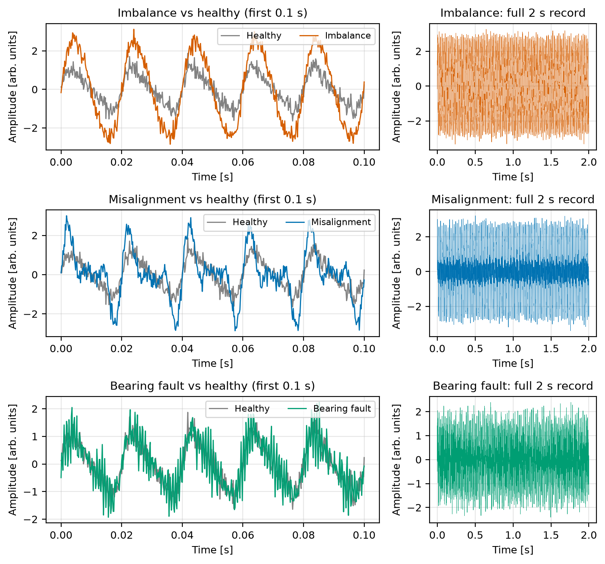

The imbalance case is clearly larger in RMS. For the bearing case the RMS is only about 12 % above healthy. The 50-run statistics (Section 3.8) show the indicators are repeatable (kurtosis standard deviation about 0.01), so the bearing case does differ from healthy (kurtosis 2.30 against 1.90, crest factor 2.88 against 2.50). However, the indicators do not map onto fault types: misalignment has the highest kurtosis (2.98), imbalance the lowest (1.53), and interpreting any of them needs a healthy baseline. They flag that something changed but not what. The waveforms in Figure 1 are also hard to interpret by eye, which is the problem the frequency domain addresses.

### 3.2 Filtering

SNR is computed against the known clean signal. For the low-pass cases the signal of interest is the whole clean waveform. For the bearing case it is the bearing term alone (the shaft harmonics count as unwanted, which the band-pass removes). "After" uses the same filter applied to the clean reference.

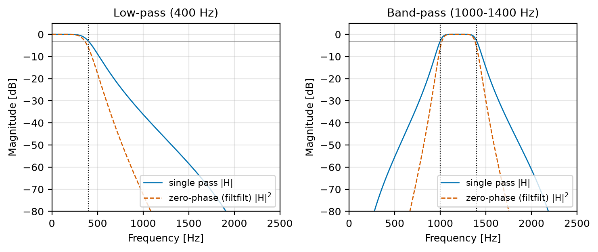

**Table 3:** Effect of filtering on SNR and noise level (single realisation).

| Case | Filter | SNR before | SNR after | Noise rms before | Noise rms after | Noise reduction |
|---|---|---|---|---|---|---|
| Imbalance | low-pass 400 Hz | 17.05 dB | 25.52 dB | 0.2502 | 0.0943 | 8.48 dB |
| Misalignment | low-pass 400 Hz | 14.02 dB | 22.41 dB | 0.2478 | 0.0943 | 8.40 dB |
| Bearing fault | band-pass 1000-1400 Hz | -5.70 dB | 12.67 dB | 0.2511 | 0.0944 | 8.50 dB |

For white noise spread over 0-2500 Hz and a 400 Hz passband, the expected power reduction is 10 log10(2500/400) = 7.96 dB. The measured 8.4-8.5 dB is close; the small difference comes from the finite filter roll-off and the particular noise realisation.

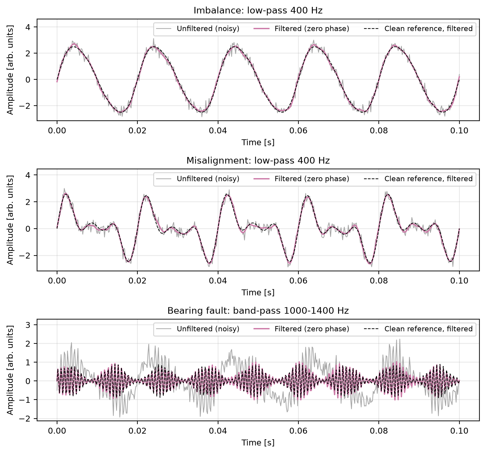

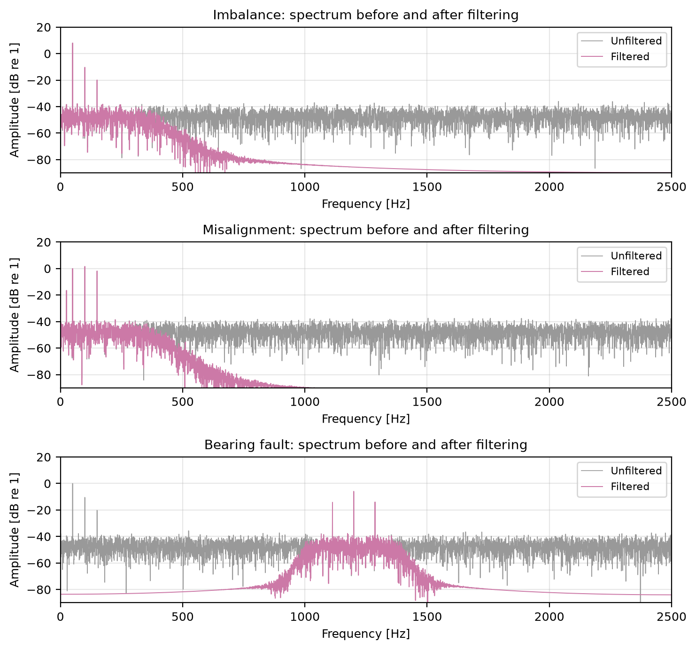

### 3.3 FFT spectra and peaks

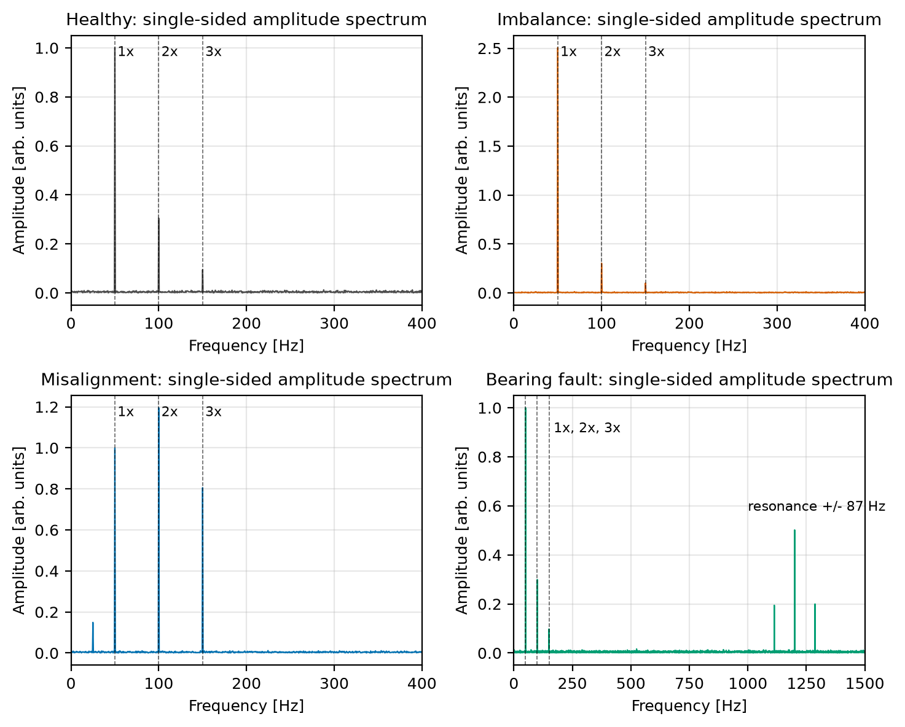

Peaks found by `find_peaks`, with the injected amplitude for comparison. The same table is saved as `results/peak_table.csv`.

**Table 4:** Detected spectral peaks against injected values.

| Case | Frequency [Hz] | Measured amplitude | Injected amplitude | Component |
|---|---|---|---|---|
| Healthy | 50.0 | 1.0008 | 1.000 | 1x |
| Healthy | 100.0 | 0.3048 | 0.300 | 2x |
| Healthy | 150.0 | 0.0947 | 0.100 | 3x |
| Imbalance | 50.0 | 2.5056 | 2.500 | 1x |
| Imbalance | 100.0 | 0.3023 | 0.300 | 2x |
| Imbalance | 150.0 | 0.1004 | 0.100 | 3x |
| Misalignment | 25.0 | 0.1491 | 0.150 | 0.5x |
| Misalignment | 50.0 | 0.9988 | 1.000 | 1x |
| Misalignment | 100.0 | 1.1953 | 1.200 | 2x |
| Misalignment | 150.0 | 0.8056 | 0.800 | 3x |
| Bearing fault | 50.0 | 0.9998 | 1.000 | 1x |
| Bearing fault | 100.0 | 0.2993 | 0.300 | 2x |
| Bearing fault | 150.0 | 0.0976 | 0.100 | 3x |
| Bearing fault | 1113.0 | 0.1946 | 0.200 | resonance - f_fault |
| Bearing fault | 1200.0 | 0.5018 | 0.500 | bearing resonance |
| Bearing fault | 1287.0 | 0.1997 | 0.200 | resonance + f_fault |

**Verification:** all 16 injected components were detected at exactly the injected frequency (error 0 Hz, within the 0.5 Hz bin spacing), no unexpected peaks appeared, and the largest amplitude error was 0.006 (Imbalance 1x and Misalignment 3x), under the 0.02 tolerance. The overall check passed. The residual errors are consistent with the noise: the per-bin amplitude standard deviation is roughly sigma * sqrt(2/N) = 0.0035.

**Observed signatures**
- Imbalance: 1x rises from 1.0 to 2.51; 2x and 3x unchanged.
- Misalignment: 2x (1.195) and 3x (0.806) become strong, and a 0.5x peak (0.149) appears.
- Bearing fault: shaft harmonics are the same as healthy, plus a resonance peak at 1200 Hz with sidebands at +/- 87 Hz.

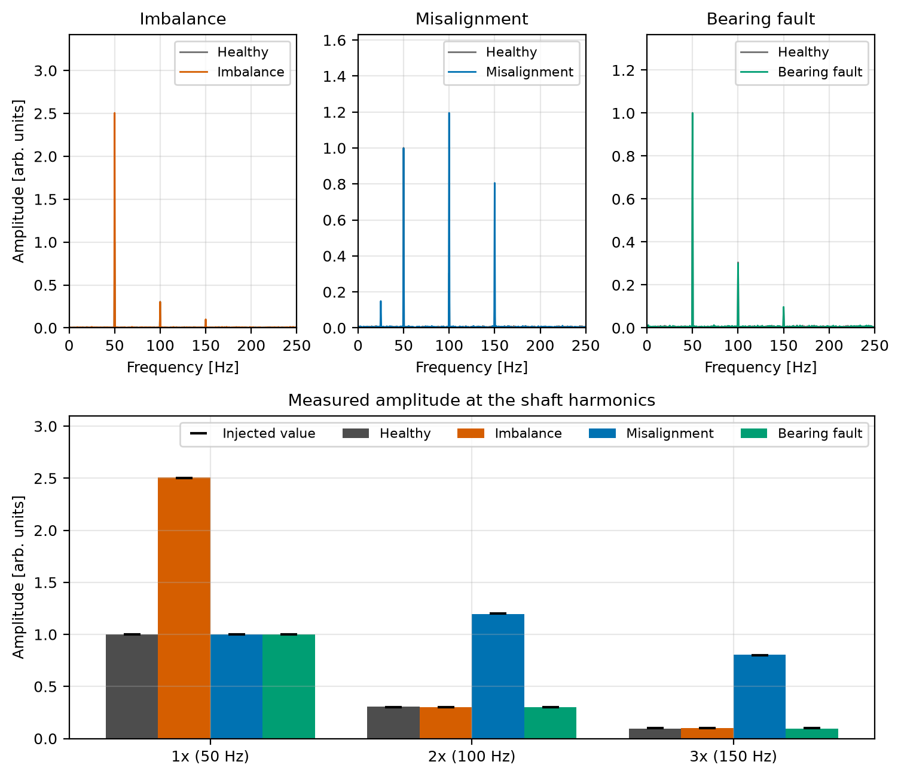

### 3.4 Window and resolution demonstrations

A unit-amplitude tone at 50 Hz (bin-aligned, rectangular window) gives a peak of 1.0000. At 50.3 Hz (off-bin) the rectangular window gives 0.7556 (24.4 % amplitude error from scalloping) and visible leakage across the spectrum (mean level -79.5 dB over 300-2000 Hz). A Hann window gives 0.9010 (9.9 % error) and far lower leakage away from the tone, at the cost of a wider main lobe.

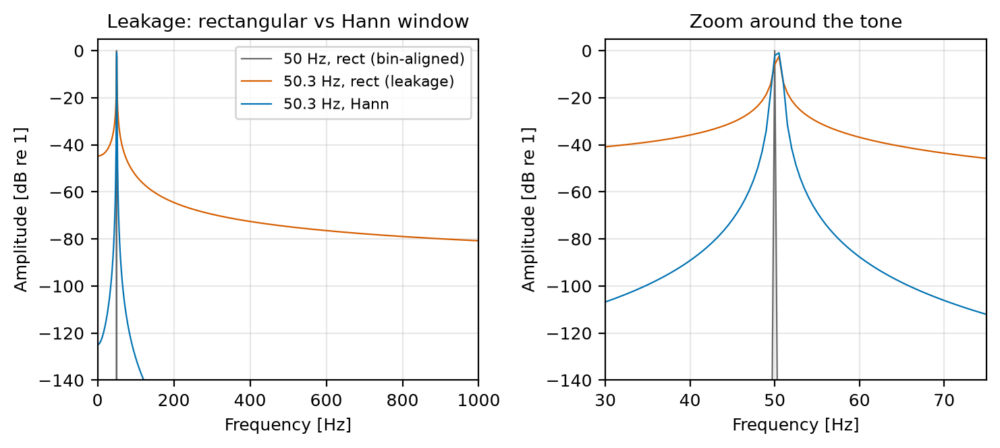

Two tones 3 Hz apart (50 and 53 Hz) were resolved only for N = 10000 (resolution 0.5 Hz); N = 500 (10 Hz) and N = 1000 (5 Hz) each showed a single peak at 50 Hz.

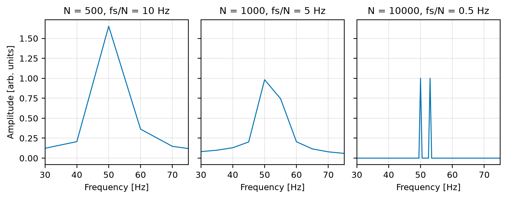

### 3.5 Envelope analysis of the bearing band

After the 1000-1400 Hz band-pass, the Hilbert envelope spectrum has its dominant peak at 87.0 Hz with amplitude 0.379 (theory for this model: A m = 0.400; noise biases the envelope slightly). The raw spectrum has amplitude 0.0067 near 87 Hz, i.e. the fault rate is invisible there and appears only in the envelope.

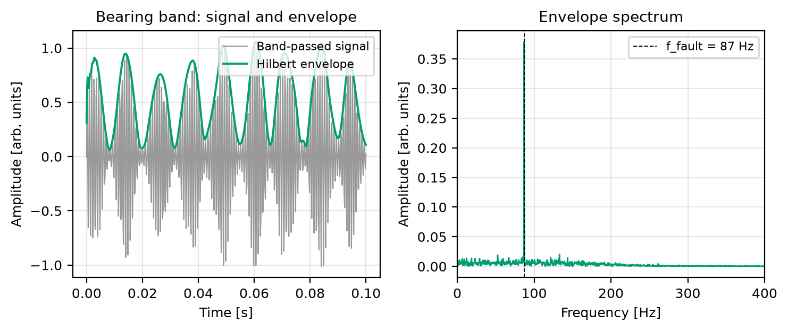

### 3.6 Toy classifier

A rule-based classifier (thresholds listed in the script) was tested on 50 noise realisations per class at sigma = 0.25.

**Table 5:** Confusion matrix of the toy classifier (50 runs per class).

| True \ Predicted | Healthy | Imbalance | Misalignment | Bearing fault |
|---|---|---|---|---|
| Healthy | 50 | 0 | 0 | 0 |
| Imbalance | 0 | 50 | 0 | 0 |
| Misalignment | 0 | 0 | 50 | 0 |
| Bearing fault | 0 | 0 | 0 | 50 |

Accuracy 100 %. **This is a toy demonstration on simulated data.** The thresholds are midpoints of amplitudes we chose ourselves, so perfect accuracy is expected and says nothing about performance on real machines.

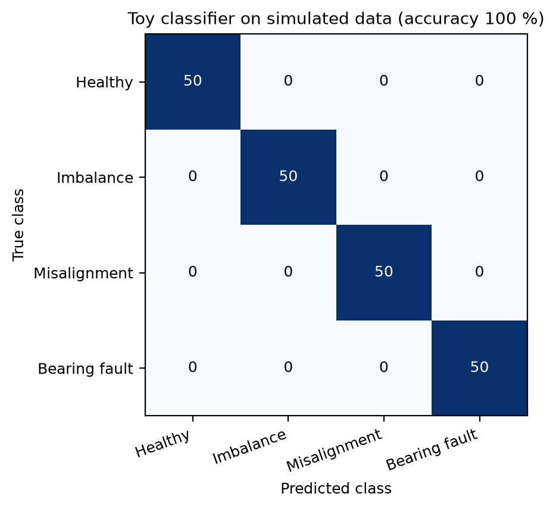

### 3.7 Noise sweep

Detection rate of each signature peak (fraction of 50 runs where the peak exceeds every other bin outside the known components) versus noise sigma.

**Table 6:** Detection rate of each signature peak and toy classifier accuracy against noise sigma (columns).

| Signature (injected amplitude) | 0.1 | 0.25 | 0.5 | 1 | 2 | 3 | 4 | 6 | 8 | 12 |
|---|---|---|---|---|---|---|---|---|---|---|
| Imbalance 1x (2.5) | 1.00 | 1.00 | 1.00 | 1.00 | 1.00 | 1.00 | 1.00 | 1.00 | 1.00 | 1.00 |
| Misalignment 2x (1.2) | 1.00 | 1.00 | 1.00 | 1.00 | 1.00 | 1.00 | 1.00 | 1.00 | 1.00 | 1.00 |
| Misalignment 3x (0.8) | 1.00 | 1.00 | 1.00 | 1.00 | 1.00 | 1.00 | 1.00 | 1.00 | 1.00 | 0.60 |
| Misalignment 0.5x (0.15) | 1.00 | 1.00 | 1.00 | 1.00 | 0.86 | 0.46 | 0.02 | 0.00 | 0.02 | 0.00 |
| Bearing sideband 1113 Hz (0.2) | 1.00 | 1.00 | 1.00 | 1.00 | 1.00 | 0.72 | 0.20 | 0.08 | 0.04 | 0.00 |
| Bearing sideband 1287 Hz (0.2) | 1.00 | 1.00 | 1.00 | 1.00 | 0.98 | 0.70 | 0.30 | 0.04 | 0.02 | 0.00 |
| Toy classifier accuracy | 1.00 | 1.00 | 1.00 | 1.00 | 1.00 | 0.98 | 0.83 | 0.42 | 0.28 | 0.25 |

The weak peaks (0.5x at 0.15, bearing sidebands at 0.2) stop being reliably detected at sigma of about 2-3 (first sigma with rate below 95 %: 2.0 for the 0.5x peak and 3.0 for both sidebands). The strong peaks survive much higher noise (the 3x peak first drops below 95 % at sigma = 12). The toy classifier stays at or above 98 % up to sigma = 3 and degrades beyond that. These thresholds apply to this signal model and N = 10000; longer records lower the per-bin noise floor.

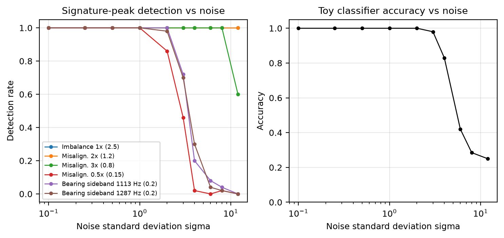

### 3.8 Statistics over 50 noise realisations

Every case was regenerated 50 times (sigma = 0.25, fresh noise each time). Values are mean +/- standard deviation (`results/mc_amplitudes.csv`).

**Table 7:** Time-domain indicators over 50 realisations.

| Case | RMS | Peak | Crest factor | Kurtosis |
|---|---|---|---|---|
| Healthy | 0.783 +/- 0.003 | 1.960 +/- 0.087 | 2.504 +/- 0.113 | 1.896 +/- 0.011 |
| Imbalance | 1.799 +/- 0.002 | 3.340 +/- 0.087 | 1.857 +/- 0.048 | 1.530 +/- 0.003 |
| Misalignment | 1.271 +/- 0.002 | 3.303 +/- 0.097 | 2.600 +/- 0.076 | 2.978 +/- 0.010 |
| Bearing fault | 0.882 +/- 0.002 | 2.540 +/- 0.097 | 2.880 +/- 0.109 | 2.303 +/- 0.015 |

**Table 8:** Spectral amplitude at the injected frequencies over 50 realisations.

| Case | Component | Injected | Mean measured | Std |
|---|---|---|---|---|
| Healthy | 1x | 1.000 | 0.9999 | 0.0040 |
| Healthy | 2x | 0.300 | 0.2999 | 0.0036 |
| Healthy | 3x | 0.100 | 0.0992 | 0.0040 |
| Imbalance | 1x | 2.500 | 2.4995 | 0.0029 |
| Imbalance | 2x | 0.300 | 0.2994 | 0.0030 |
| Imbalance | 3x | 0.100 | 0.1003 | 0.0035 |
| Misalignment | 0.5x | 0.150 | 0.1503 | 0.0037 |
| Misalignment | 1x | 1.000 | 1.0003 | 0.0027 |
| Misalignment | 2x | 1.200 | 1.2004 | 0.0032 |
| Misalignment | 3x | 0.800 | 0.7999 | 0.0033 |
| Bearing fault | 1x | 1.000 | 1.0002 | 0.0033 |
| Bearing fault | 2x | 0.300 | 0.3001 | 0.0037 |
| Bearing fault | 3x | 0.100 | 0.1000 | 0.0038 |
| Bearing fault | resonance - f_fault (1113 Hz) | 0.200 | 0.2005 | 0.0035 |
| Bearing fault | resonance (1200 Hz) | 0.500 | 0.5008 | 0.0036 |
| Bearing fault | resonance + f_fault (1287 Hz) | 0.200 | 0.2002 | 0.0031 |

The mean measured amplitude differs from the injected value by at most 0.0008, and the standard deviation (0.0027-0.0040) matches the theoretical per-bin value sigma * sqrt(2/N) = 0.0035. So the single-run errors of up to 0.006 in Section 3.3 are ordinary noise scatter, not bias.

**Table 9:** Filtering performance over 50 realisations.

| Case | SNR before [dB] | SNR after [dB] | Noise reduction [dB] |
|---|---|---|---|
| Imbalance (low-pass) | 17.07 +/- 0.07 | 25.50 +/- 0.18 | 8.44 +/- 0.16 |
| Misalignment (low-pass) | 13.95 +/- 0.07 | 22.36 +/- 0.13 | 8.41 +/- 0.12 |
| Bearing fault (band-pass) | -5.70 +/- 0.03 | 12.67 +/- 0.17 | 8.45 +/- 0.16 |

The noise reduction is 8.4 dB on average with a spread of about 0.15 dB, so the single-run values in Section 3.2 were typical. It is about 0.5 dB above the 7.96 dB estimate, which assumes ideal brick-wall filters.

## 4. Extended Studies

These studies go beyond the core scope of the synopsis. They stay within the simulation-only framework and use the same tools. They use their own random stream (seed 42 reset at the start), 20 runs per average unless stated, and sigma = 0.25 unless stated.

### 4.1 Real bearing frequencies and an impulsive bearing model

For a rolling-element bearing with n balls, ball diameter d, pitch diameter D, contact angle phi and shaft frequency f_r (outer race fixed): BPFO = (n/2) f_r (1 - (d/D) cos phi), BPFI = (n/2) f_r (1 + (d/D) cos phi), BSF = (D/2d) f_r (1 - ((d/D) cos phi)^2) and FTF = (f_r/2)(1 - (d/D) cos phi). The geometry used (9 balls, d = 7.94 mm, D = 39.04 mm, phi = 0) is typical of a 6205-type deep-groove bearing; these are assumed catalogue-style values, not measured data. They give the frequencies in Table 10. BPFO falls at 358.478 bins of 0.5 Hz, so it is **not** bin-aligned (nearest bin 179.0 Hz).

**Table 10:** Bearing characteristic frequencies at f_r = 50 Hz.

| Frequency | Order (x f_r) | Value [Hz] |
|---|---|---|
| FTF (cage) | 0.3983 | 19.92 |
| BPFO (outer race) | 3.5848 | 179.24 |
| BPFI (inner race) | 5.4152 | 270.76 |
| BSF (ball spin) | 2.3567 | 117.84 |

The impulsive model replaces the amplitude modulation of Section 2.1 by a train of decaying resonance bursts at BPFO: x(t) = sum over k of A exp(-(t - t_k)/tau) sin(2 pi f_res (t - t_k)) for t >= t_k, with t_k = (k + jitter * randn) / BPFO, A = 3.0, tau = 0.5 ms, f_res = 1200 Hz and 1 % arrival-time jitter, added to the healthy signal and noise.

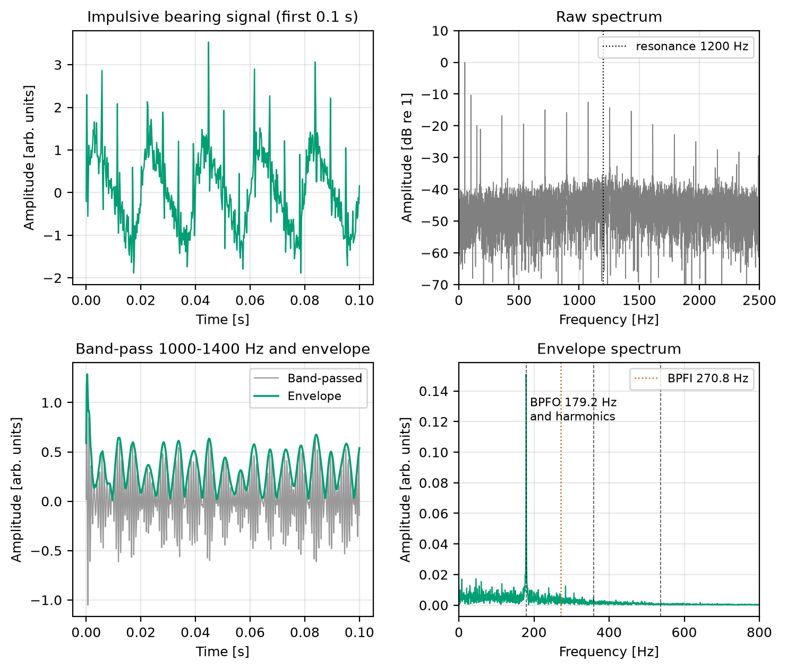

Envelope analysis (band-pass 1000-1400 Hz, Hilbert envelope, FFT) puts the dominant peak at 179.0 Hz (BPFO = 179.24 Hz, within the 0.5 Hz bin spacing) with amplitude 0.151 against a median envelope-spectrum floor of 0.0007. The envelope amplitude near BPFI (270.76 Hz), which was not injected, is only 0.0047, so the peak identifies the outer race rather than the inner race. In this simplified model the raw spectrum also shows a line near BPFO (amplitude 0.0887), because the simulated bursts are broadband; real impacts are usually masked at low frequency by other vibration, which is why envelope analysis is used.

**Table 11:** Kurtosis (mean +/- std over 20 runs) of the raw signal, the signal high-passed above 500 Hz, and the 1000-1400 Hz band-passed signal. The crest factor of the high-passed signal is also given.

| Signal | Kurtosis, raw | Kurtosis, > 500 Hz | Crest factor, > 500 Hz | Kurtosis, 1-1.4 kHz |
|---|---|---|---|---|
| Healthy | 1.896 +/- 0.010 | 2.993 +/- 0.047 | 4.065 +/- 0.276 | 2.996 +/- 0.114 |
| Bearing (AM model) | 2.298 +/- 0.014 | 2.779 +/- 0.019 | 3.347 +/- 0.106 | 2.683 +/- 0.021 |
| Bearing (impulsive) | 2.879 +/- 0.040 | 6.932 +/- 0.122 | 4.997 +/- 0.195 | 2.690 +/- 0.036 |

The impulsive model raises the kurtosis, which the AM model does not: above 500 Hz it is 6.93 against 2.99 for healthy (a Gaussian-noise value), while the AM model stays at 2.78. After the narrow 1000-1400 Hz band-pass, however, the impulsive kurtosis is only 2.69. A 400 Hz wide filter rings for several milliseconds and smears the 0.5 ms bursts into each other, so the choice of filter band affects the indicator. This is the time-frequency trade-off again, and it is why methods such as the kurtogram search for the band that maximises kurtosis.

**Table 12:** Envelope-spectrum line amplitude at the fault frequency (mean of 20 runs) for a bin-aligned and a non-aligned fault frequency, with random jitter.

| Case | Rectangular window | Hann window |
|---|---|---|
| Aligned, f = 179.0 Hz, no jitter | 0.2257 | 0.2251 |
| BPFO = 179.24 Hz, no jitter | 0.1477 | 0.1920 |
| BPFO = 179.24 Hz, jitter 1 % | 0.1491 | 0.1935 |
| BPFO = 179.24 Hz, jitter 3 % | 0.1508 | 0.1965 |

Because BPFO is 0.24 Hz from the nearest bin, the rectangular window reads the same bursts about 35 % too low (0.1477 against 0.2257 for the aligned case) and the Hann window about 15 % too low (0.1920 against 0.2251). This is the scalloping loss of Section 3.4 appearing in a realistic bearing frequency. Jitter of up to 3 % of the period did not reduce the envelope line in this model.

### 4.2 Welch (averaged) spectrum

A single FFT of a noisy record has a random noise floor: each bin is Rayleigh distributed, with a standard deviation of 52 % of the mean. `scipy.signal.welch` averages the power spectra of overlapping Hann-windowed segments, which shrinks that scatter but widens the bins (f_s/nperseg). With 50 % overlap, nperseg = 2000 gives 9 segments (2.5 Hz bins) and nperseg = 1000 gives 19 segments (5 Hz bins). The amplitude is sqrt(2 Pxx) with `scaling='spectrum'`. At sigma = 4 the noise-only floor behaves as in Table 13.

**Table 13:** Noise-floor scatter at sigma = 4 (bins above 100 Hz, mean of 20 runs): coefficient of variation (std / mean) and the largest bin relative to the mean floor.

| Spectrum | CV of floor | Largest bin / mean floor [dB] |
|---|---|---|
| FFT, N = 10000 | 0.522 | 10.78 |
| Single FFT, N = 2000 (Hann) | 0.518 | 9.24 |
| Welch, nperseg = 2000 | 0.172 | 4.12 |
| Single FFT, N = 1000 (Hann) | 0.520 | 9.31 |
| Welch, nperseg = 1000 | 0.118 | 2.70 |

The measured CV of 0.52 matches the Rayleigh value sqrt(4/pi - 1) = 0.523. Averaging cuts the scatter to 0.17 and 0.12 and the largest noise bin from about 10 dB above the mean floor to 4.1 and 2.7 dB.

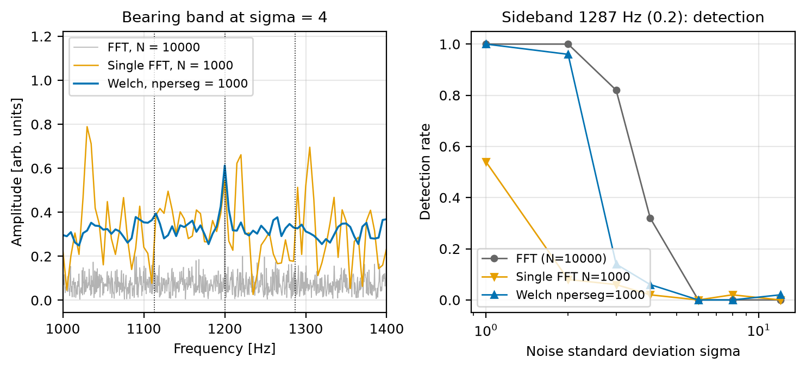

**Table 14:** Detection rate against noise sigma (columns) for the two weakest signature peaks, 50 runs per point.

| Signature and spectrum | 1 | 2 | 3 | 4 | 6 | 8 | 12 |
|---|---|---|---|---|---|---|---|
| Sideband 1287 Hz, FFT N = 10000 | 1.00 | 1.00 | 0.82 | 0.32 | 0.00 | 0.00 | 0.00 |
| Sideband 1287 Hz, single FFT N = 2000 | 0.90 | 0.08 | 0.00 | 0.02 | 0.00 | 0.00 | 0.02 |
| Sideband 1287 Hz, Welch nperseg = 2000 | 1.00 | 0.98 | 0.46 | 0.14 | 0.04 | 0.00 | 0.00 |
| Sideband 1287 Hz, single FFT N = 1000 | 0.54 | 0.08 | 0.06 | 0.02 | 0.00 | 0.02 | 0.00 |
| Sideband 1287 Hz, Welch nperseg = 1000 | 1.00 | 0.96 | 0.14 | 0.06 | 0.00 | 0.00 | 0.02 |
| Misalignment 0.5x, FFT N = 10000 | 1.00 | 0.84 | 0.24 | 0.08 | 0.02 | 0.00 | 0.00 |
| Misalignment 0.5x, single FFT N = 2000 | 0.58 | 0.08 | 0.00 | 0.00 | 0.00 | 0.00 | 0.00 |
| Misalignment 0.5x, Welch nperseg = 2000 | 1.00 | 0.68 | 0.14 | 0.06 | 0.02 | 0.00 | 0.00 |
| Misalignment 0.5x, single FFT N = 1000 | 0.22 | 0.02 | 0.02 | 0.02 | 0.00 | 0.00 | 0.00 |
| Misalignment 0.5x, Welch nperseg = 1000 | 1.00 | 0.48 | 0.10 | 0.08 | 0.00 | 0.00 | 0.00 |

Averaging helps a lot compared with a single FFT of the same segment length: at sigma = 2 the 1287 Hz sideband is found in 96-98 % of runs with Welch against 8 % with a single short FFT. It does **not**, however, beat the single full-length FFT for these stationary tones (at sigma = 3: 0.82 for the full FFT against 0.46 and 0.14 for Welch). The reason is that a longer record integrates a stationary tone coherently and concentrates the noise into narrower bins (noise per bin falls with bin width), whereas Welch averaging only reduces the scatter of the floor, not its level, and uses coarser bins. In practice, the best way to detect a weak stationary line is a longer record; Welch is the right tool for a smooth, low-variance estimate of the noise floor or broadband content, for records that are not stationary over their whole length, and when the tone is not bin-aligned.

### 4.3 Short-time Fourier transform: a fault that starts mid-record

The machine is healthy for the first second and imbalanced (1x amplitude 1.0 to 2.5) for the second half. The STFT was written by hand (Hann windows, hop 100 samples = 0.02 s).

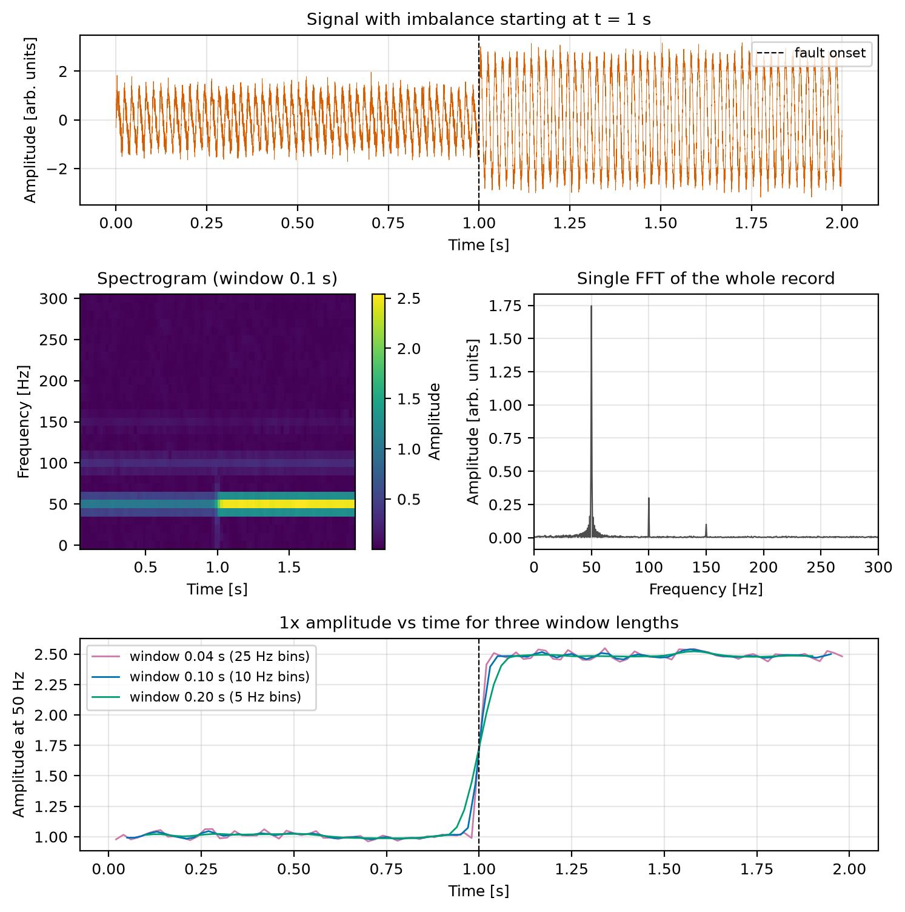

A single FFT reports one blended 1x amplitude of 1.746 (the time average of the two levels is 1.750) and no timing information. The STFT recovers both levels and the time of the change.

**Table 15:** STFT of the 1x component for three window lengths (true onset at 1.000 s).

| Window length [s] | Bin width [Hz] | 1x before | 1x after | 10-90 % rise time [s] | Onset estimate [s] |
|---|---|---|---|---|---|
| 0.04 | 25.0 | 1.004 | 2.486 | 0.020 | 1.020 |
| 0.10 | 10.0 | 1.008 | 2.485 | 0.040 | 1.010 |
| 0.20 | 5.0 | 1.015 | 2.483 | 0.100 | 1.020 |

The rise time grows with the window length (roughly half the window), so a longer window gives finer frequency resolution but blurs the transition in time. For the shortest window the rise time equals the hop spacing (0.02 s), so it is limited by the hop. This is the fixed time-frequency trade-off.

### 4.4 Drifting shaft speed and order tracking

The shaft speed ramps linearly from 50 to 56 Hz over the 2 s record (exactly 106 revolutions), with the misalignment amplitudes. Each harmonic k then sweeps from 50k to 56k Hz.

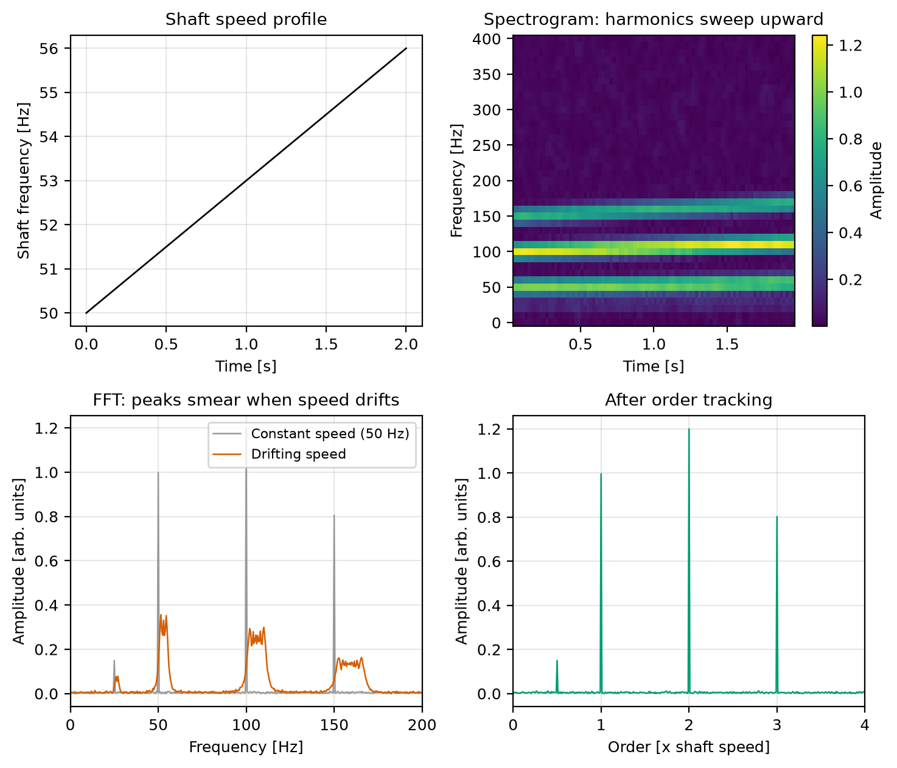

Order tracking resamples the signal at equal shaft-angle steps (the known speed profile stands in for a tachometer), so the harmonics become fixed orders again.

**Table 16:** Misalignment amplitudes at constant speed, with drifting speed (largest value in the swept band) and after order tracking.

| Harmonic | Injected | Constant-speed FFT | Drifting-speed FFT (max) | Bins above 0.05 | Order spectrum |
|---|---|---|---|---|---|
| 0.5x | 0.150 | 0.149 | 0.078 | 5 | 0.150 |
| 1x | 1.000 | 0.999 | 0.356 | 17 | 0.997 |
| 2x | 1.200 | 1.195 | 0.299 | 29 | 1.200 |
| 3x | 0.800 | 0.806 | 0.163 | 39 | 0.802 |

With the drift, each peak drops to 20-36 % of its true height (for the harmonics 1x to 3x; 52 % for 0.5x) and spreads over 17-39 bins, growing with harmonic number because higher harmonics sweep a wider band. After order tracking the amplitudes are within 0.003 of the injected values and the peaks are sharp again. The 106 revolutions make every order, including 0.5x, fall on a bin; with an odd number of revolutions the 0.5x peak would not be aligned.

### 4.5 Comparison of low-pass filters

Candidate 400 Hz low-pass filters were applied causally (single pass), so that delay and phase effects are visible: Butterworth of orders 2 to 8, Chebyshev I (order 4, 1 dB ripple), Bessel (order 4) and a 101-tap Hamming-window FIR filter. The noise reduction was measured with 200000 samples of white noise.

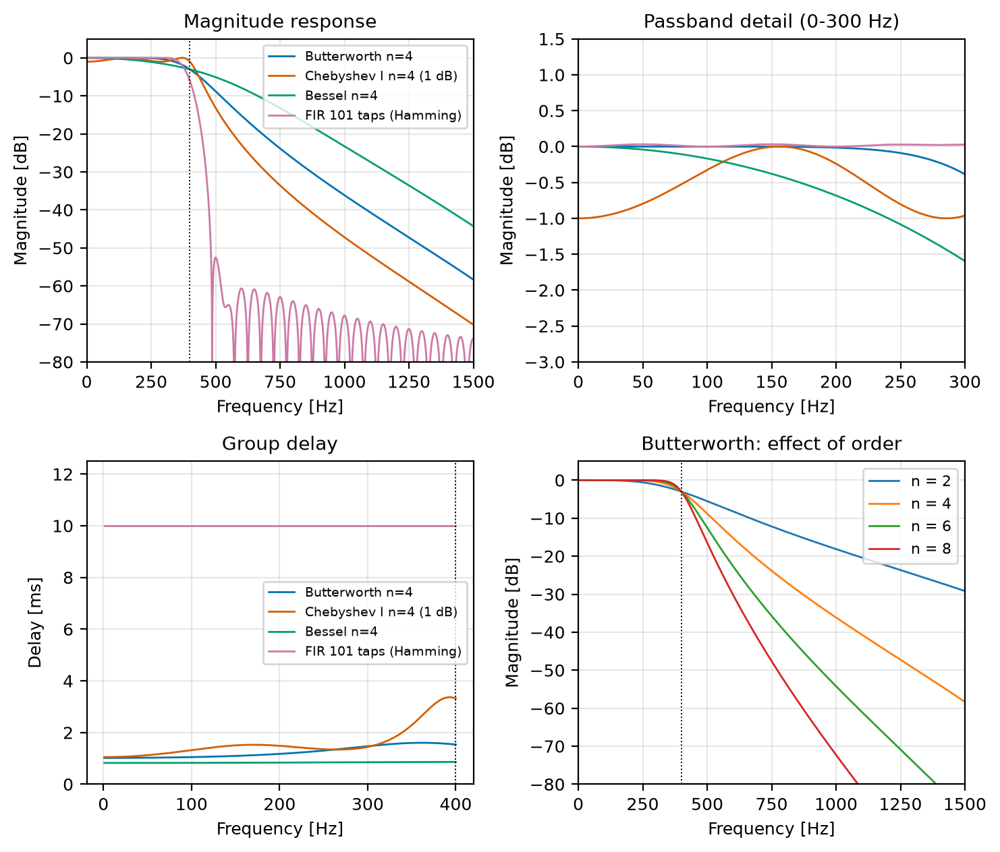

**Table 17:** Low-pass filter comparison (fc = 400 Hz, causal single pass). Gain is at the shaft harmonics 1x, 2x, 3x; delay is the group delay at 50 Hz; the delay change is the group delay at 150 Hz minus that at 50 Hz.

| Filter | Gain 50 Hz [dB] | Gain 100 Hz [dB] | Gain 150 Hz [dB] | -3 dB freq [Hz] | Gain 800 Hz [dB] | Noise reduction [dB] | Delay [ms] | Delay change [ms] |
|---|---|---|---|---|---|---|---|---|
| Butterworth n=4 | -0.00 | -0.00 | -0.00 | 400 | -26.5 | 7.87 | 1.03 | 0.07 |
| Chebyshev I n=4 (1 dB) | -0.80 | -0.33 | -0.00 | 420 | -36.6 | 8.11 | 1.12 | 0.38 |
| Bessel n=4 | -0.04 | -0.17 | -0.38 | 399 | -15.2 | 7.85 | 0.82 | 0.01 |
| FIR 101 taps (Hamming) | 0.03 | -0.00 | 0.03 | 380 | -64.0 | 8.17 | 10.00 | 0.00 |
| Butterworth n=2 | -0.00 | -0.02 | -0.08 | 400 | -13.4 | 7.62 | 0.56 | 0.06 |
| Butterworth n=6 | -0.00 | -0.00 | -0.00 | 400 | -39.7 | 7.92 | 1.51 | 0.09 |
| Butterworth n=8 | -0.00 | -0.00 | -0.00 | 400 | -52.9 | 7.94 | 2.01 | 0.11 |

- **Butterworth** has a maximally flat passband: the 1x, 2x and 3x amplitudes are unchanged to within 0.00 dB. Raising the order from 2 to 8 improves attenuation at 800 Hz from -13.4 to -52.9 dB (about 13 dB per two orders) at the cost of more delay (0.56 to 2.01 ms).
- **Chebyshev I** is steeper (-36.6 dB at 800 Hz for the same order) but its 1 dB passband ripple changes the harmonic amplitudes by up to 0.80 dB (about 9 %) at 50 Hz, and its delay varies more across the passband (0.38 ms).
- **Bessel** has the flattest delay (0.01 ms change) but a slowly rounded passband (-0.38 dB at 150 Hz) and the weakest attenuation (-15.2 dB at 800 Hz).
- **FIR** has a flat passband, exactly linear phase and -64 dB at 800 Hz, but needs 101 coefficients and a constant 10 ms delay ((101 - 1)/2 samples).

For this project the peak amplitudes at the shaft harmonics are the quantities of interest, so amplitude flatness matters most, which favours Butterworth; order 4 is a balance between roll-off and complexity. The processing is offline and uses forward-backward filtering, so delay and phase distortion are not an issue here. The measured noise reductions (7.6-8.2 dB) are close to the ideal 7.96 dB.

### 4.6 Severity sweep (trending)

In predictive maintenance the amplitude at a fault frequency is trended over time. The injected imbalance 1x amplitude was raised from 1.0 to 4.0 with 20 noise realisations per point.

**Table 18:** Measured 1x amplitude and overall RMS against injected severity (mean +/- std over 20 runs); the theoretical RMS is sqrt((a1^2 + a2^2 + a3^2)/2 + sigma^2).

| Injected 1x | Measured 1x | RMS | RMS theory |
|---|---|---|---|
| 1.00 | 0.9996 +/- 0.0038 | 0.7824 +/- 0.0025 | 0.7826 |
| 1.50 | 1.5000 +/- 0.0032 | 1.1127 +/- 0.0024 | 1.1124 |
| 2.00 | 1.9982 +/- 0.0036 | 1.4521 +/- 0.0027 | 1.4534 |
| 2.50 | 2.5002 +/- 0.0031 | 1.7993 +/- 0.0020 | 1.7993 |
| 3.00 | 2.9997 +/- 0.0028 | 2.1475 +/- 0.0020 | 2.1477 |
| 3.50 | 3.4997 +/- 0.0026 | 2.4972 +/- 0.0018 | 2.4975 |
| 4.00 | 3.9999 +/- 0.0040 | 2.8482 +/- 0.0028 | 2.8482 |

A straight-line fit of measured against injected 1x gives slope 1.0001 and intercept -0.0007, so the spectral amplitude tracks severity linearly with a scatter of about 0.003-0.004. The overall RMS also follows its theoretical value (largest difference 0.0013) but is a non-linear function of the severity and mixes all components.

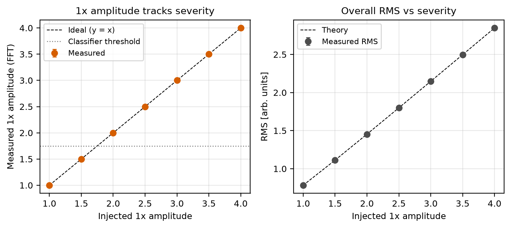

### 4.7 Combined faults

The toy classifier of Section 3.6 returns a single label using a fixed rule order (bearing, then misalignment, then imbalance). A multi-label version applies each rule independently and returns every fault whose rule fires. Both were tested on 50 runs per class, including combinations of faults.

**Table 19:** Single-label predictions and the multi-label exact-match rate for single and combined faults.

| True class | Single-label predictions (50 runs) | Multi-label exactly correct |
|---|---|---|
| Healthy | Healthy: 50 | 100 % |
| Imbalance | Imbalance: 50 | 100 % |
| Misalignment | Misalignment: 50 | 100 % |
| Bearing fault | Bearing fault: 50 | 100 % |
| Imbalance + Misalignment | Misalignment: 50 | 100 % |
| Imbalance + Bearing | Bearing fault: 50 | 100 % |
| Misalignment + Bearing | Bearing fault: 50 | 100 % |

A single-label classifier can report only one fault, so it gives the complete diagnosis for none of the combined cases: it reports Misalignment for imbalance plus misalignment and Bearing fault for every combination containing a bearing fault, hiding the other fault. The multi-label rules report both faults in all 50 runs of each combination. As before, the thresholds come from the simulated model, so this shows how the rule design matters and not real-world performance.

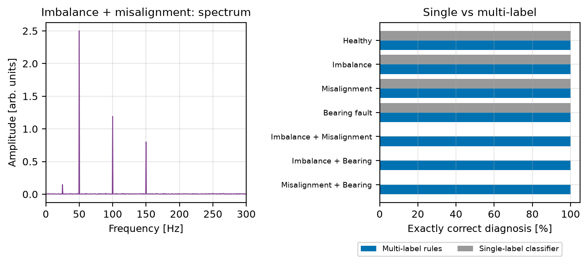

### 4.8 Cross-checks of the FFT

The FFT results were checked three ways. First, a direct O(N^2) DFT (`X[k] = sum x[n] exp(-2j pi k n / N)` as a matrix product) agrees with `np.fft.fft` for N = 2000 to within 9.88e-11 (the largest spectrum magnitude is 1000.8, so a relative difference of about 1e-13). Second, Parseval's theorem holds to rounding error for all four noisy signals (Table 20). Third, the run time follows the expected complexity.

**Table 20:** Parseval's theorem: energy in time, energy in frequency (full FFT) and energy from the single-sided spectrum.

| Case | Sum of x^2 | Sum of abs(X)^2 / N | Relative error | Single-sided sum | Relative error |
|---|---|---|---|---|---|
| Healthy | 6146.874 | 6146.874 | 1.5e-16 | 6146.874 | 0.0e+00 |
| Imbalance | 32522.401 | 32522.401 | 0.0e+00 | 32522.401 | 0.0e+00 |
| Misalignment | 16101.115 | 16101.115 | 3.4e-16 | 16101.115 | 2.3e-16 |
| Bearing fault | 7771.253 | 7771.253 | 3.5e-16 | 7771.253 | 3.5e-16 |

The run time of the direct DFT grows with a log-log slope of 1.98 (N = 128 to 2048; theory 2), while the FFT has a slope of 1.19 (N = 2^15 to 2^20; theory slightly above 1 for N log N). At N = 2048 the direct DFT took about 67 ms and the FFT about 0.014 ms, roughly 4700 times faster. These timings depend on the machine and change slightly from run to run.

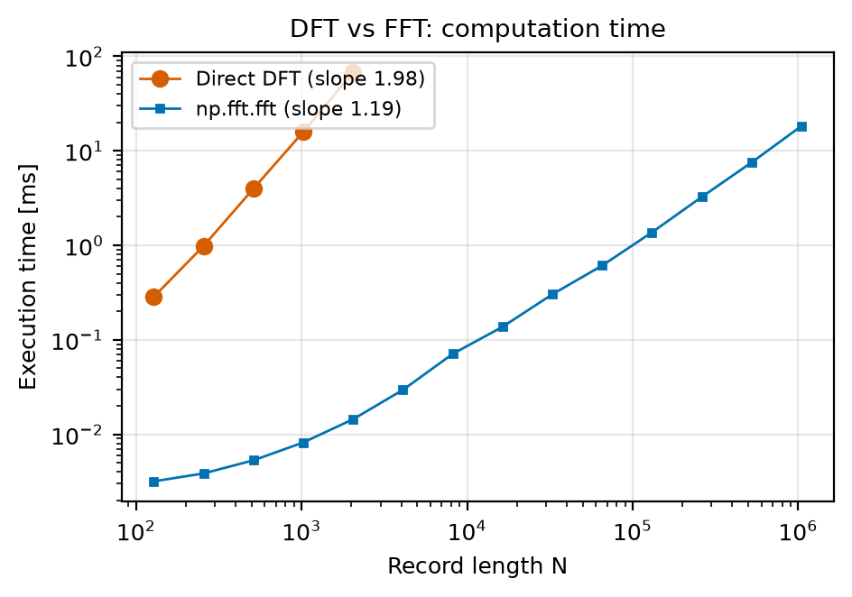

## 5. Discussion

**Usefulness.** The FFT turns a waveform that is hard to read into a small set of peaks. Each simulated fault leaves a distinct frequency signature: imbalance raises 1x, misalignment raises 2x and 3x (with a 0.5x component), and the bearing fault adds a resonance with sidebands spaced by the fault frequency. Peak positions and amplitudes were recovered to within the bin resolution and within noise-level amplitude error, and the 50-run statistics show no measurable bias. Filtering improved SNR by about 8.4-8.5 dB (close to the 7.96 dB white-noise estimate) without changing the fault peaks. The envelope spectrum recovered the 87 Hz fault rate that is not visible in the raw spectrum.

**Time-domain statistics alone** (Sections 3.1 and 3.8) detect that the signal changed but do not identify the fault: the indicators do not order consistently by fault type and need a healthy reference. This supports the case for spectral analysis.

**What the extended studies add.**
- A realistic bearing frequency is rarely bin-aligned (Section 4.1): the rectangular window under-reads the BPFO line by about 35 % and Hann by about 15 %, so amplitude should be read with care and the window chosen deliberately.
- An impulsive bearing model raises the kurtosis (6.93 above 500 Hz against 2.99 healthy) where the amplitude-modulation model does not, but a narrow band-pass can hide that increase.
- Averaging (Welch) reduces the scatter of the noise floor but does not beat a long coherent FFT for stationary tones (Section 4.2); recording longer is the most effective way to find weak lines.
- A fault that starts mid-record is invisible as an event in a single FFT, which reports a blended amplitude (1.746), while the STFT shows when it began; the cost is frequency resolution (Section 4.3).
- Speed variation smears harmonics to 20-36 % of their height and over up to 39 bins, and order tracking restores them (Section 4.4).
- Butterworth was chosen for passband flatness; the alternatives trade that for steeper roll-off (Chebyshev), flatter delay (Bessel) or linear phase at a cost in length and delay (FIR) (Section 4.5).
- The 1x amplitude tracks severity linearly (Section 4.6), which is the basis for trending, and a single-label classifier cannot represent two simultaneous faults (Section 4.7).

## 6. Limitations

- **Simulation only.** Signals are synthetic; the noise is white Gaussian. Conclusions are limited to this model and are not validation on real machinery.
- **Oversimplified fault models.** Real faults are not clean stationary tones at exact harmonics. The amplitude-modulated bearing model is a pure periodic modulation. The impulsive model (Section 4.1) is closer but still has constant impact amplitude, a single resonance, no modulation by the load zone or by shaft rotation, and only small random jitter. The bearing frequency formulas assume pure rolling without slip and a geometry that is assumed here, not measured.
- **Real bearing faults need envelope analysis.** On real data the information sits in the demodulated envelope of a band around a structural resonance, which has to be found; the choice of band changes the result (Table 11).
- **Non-stationary signals.** The FFT assumes stationarity over the record. Section 4.3 shows the consequence and the STFT remedy, whose time and frequency resolution are tied together.
- **Variable speed.** Section 4.4 uses a known, smooth, linear speed profile. Real speed signals are noisy and need a tachometer or a speed estimate for order tracking.
- **Leakage.** In the core study peaks were bin-aligned by design. Real frequencies are not, so windowing is needed, and it costs resolution (Sections 3.4 and 4.1).
- **Fixed time-frequency trade-off.** Frequency resolution is f_s/N = 1/T. Finer resolution needs a longer record, which reduces time localisation (Sections 3.4 and 4.3).
- **Toy classifiers.** Thresholds were set from the simulated model; the 100 % results (Sections 3.6 and 4.7) are not a performance claim.
- **Noise model.** Sections 3.1-3.3 use one noise realisation; Section 3.8 repeats them over 50 realisations. All noise is white Gaussian with a fixed sigma; real noise is usually coloured and varies with operating conditions.
- **Timing results** in Section 4.8 depend on the computer used.

## 7. Conclusion

In simulation, an FFT with a bin-aligned sampling setup (f_s = 5000 Hz, N = 10000, 0.5 Hz resolution) located every injected component at its exact frequency, with amplitude errors of at most 0.006 in one run and mean errors of at most 0.0008 over 50 runs, and showed distinct spectral signatures for imbalance, misalignment and a simplified bearing fault. Zero-phase Butterworth filtering raised SNR by about 8.4-8.5 dB, and envelope analysis exposed the bearing fault rate that the raw spectrum did not show. Weak fault peaks became undetectable at noise levels of about sigma = 2-3 in this model.

The extended studies showed that a realistic, non-aligned bearing frequency (BPFO = 179.24 Hz) is under-read by the rectangular window, that an impulsive model raises kurtosis where an AM model does not, that Welch averaging smooths the noise floor but does not outperform a long FFT for stationary tones, that a mid-record fault and a drifting speed defeat a single FFT but are handled by the STFT and order tracking respectively, and that the 1x amplitude trends linearly with severity. These results hold for the chosen signal models only; checking them on real vibration measurements remains future work.

## References

1. A. V. Oppenheim and R. W. Schafer, *Discrete-Time Signal Processing*, Pearson.
2. SciPy documentation, Signal Processing: https://docs.scipy.org/doc/scipy/reference/signal.html
3. NumPy documentation: https://numpy.org/doc/
4. MTE 3121: Digital Signal Processing, Mini Project Guidelines, Department of Mechatronics, Manipal Institute of Technology, 2026.

## Appendix: files

| File | Content |
|---|---|
| `vibration_analysis.py` | full pipeline (core steps and extended studies) |
| `vibration_analysis.ipynb` | same pipeline as a notebook (generated by `build_notebook.py`) |
| `figures/01_time_domain.png` | Figure 1 |
| `figures/02_filter_response.png` | Figure 2 |
| `figures/03_filtering_time.png` | Figure 3 |
| `figures/04_filtering_spectrum.png` | Figure 4 |
| `figures/05_spectra_all.png` | Figure 5 |
| `figures/08_comparison.png` | Figure 6 |
| `figures/06_window_leakage.png` | Figure 7 |
| `figures/07_resolution_vs_N.png` | Figure 8 |
| `figures/09_envelope_bearing.png` | Figure 9 |
| `figures/10_confusion_matrix.png` | Figure 10 |
| `figures/11_noise_sweep.png` | Figure 11 |
| `figures/12_impulsive_bearing.png` to `figures/19_dft_vs_fft_timing.png` | Figures 12 to 19 |
| `results/peak_table.csv`, `results/mc_amplitudes.csv`, `results/summary.txt` | numeric outputs |
| `tests/test_vibration_analysis.py` | unit tests |
